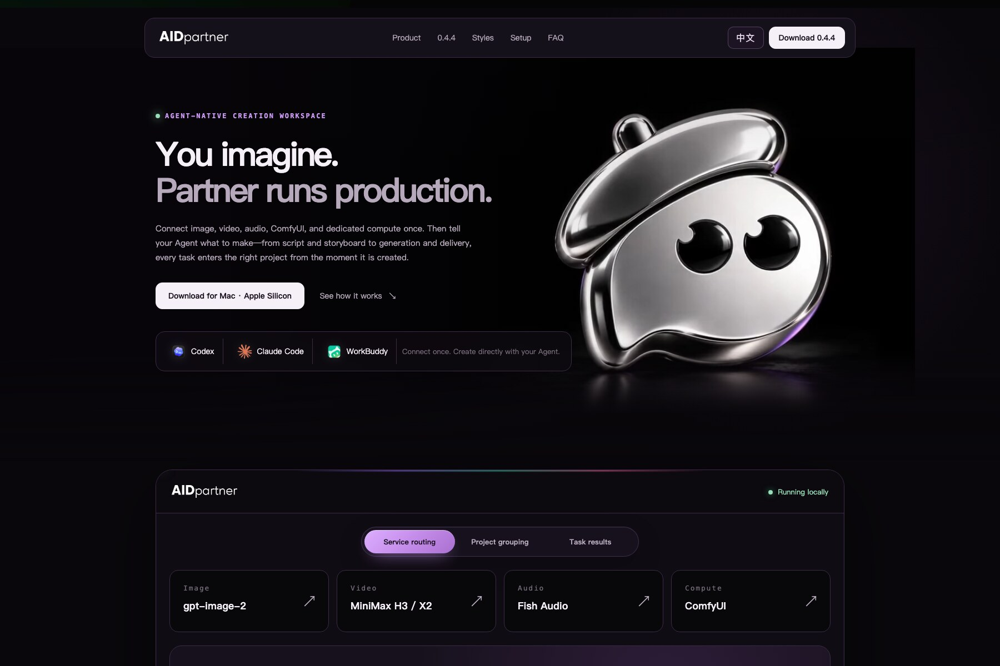
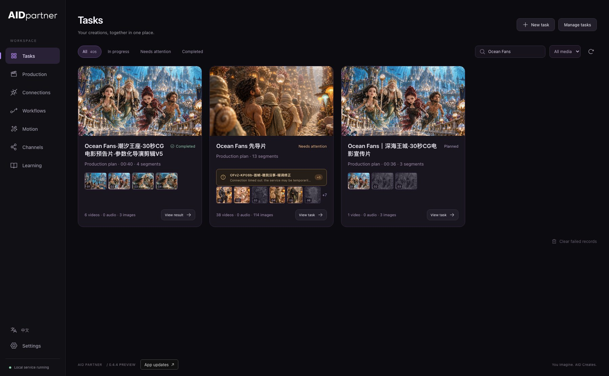
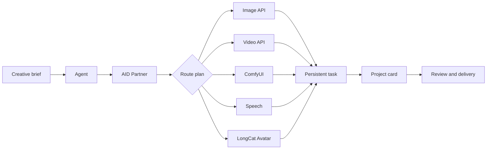
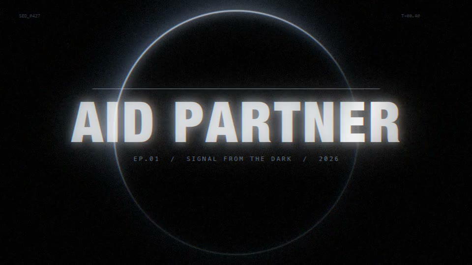

<div align="center">
  

  # AID Partner

  ### You imagine. Partner runs production.

  **A local, Agent-native production hub for image, video, audio, ComfyUI, dedicated compute, and project delivery.**

  [](https://github.com/unclewongwong/aid/releases/tag/aid-partner-v0.4.4)
  [](#download)
  [](#download)
  [](#security-boundaries)

  [Website](https://aidp.app) · [Download](#download) · [Product tour](#product-tour) · [Production samples](#production-samples) · [Architecture](#how-it-works)
</div>

<br />

<a href="https://aidp.app">
  
</a>

<p align="center"><sub>The public website defaults to English and can be switched to Chinese. Language preference is remembered locally.</sub></p>

---

## What AID Partner is

AID Partner connects the creative services you already use to an Agent. Configure an image API, video API, speech service, ComfyUI host, or dedicated inference service once; then work through natural-language production requests in Codex, Claude Code, or WorkBuddy.

The Agent handles intent, story, shot planning, prompts, references, routing, and delivery. Partner keeps credentials local, adapts each provider correctly, persists long-running work, and keeps every asset attached to the right project.

<table>
  <tr>
    <td width="25%"><b>Agent-native</b><br /><sub>No duplicate generation form. The Agent prepares and calls production tools directly.</sub></td>
    <td width="25%"><b>Service-agnostic</b><br /><sub>API services, ComfyUI workflows, dedicated inference, and opt-in private channels.</sub></td>
    <td width="25%"><b>Project-aware</b><br /><sub>Shots, references, audio, videos, scripts, and execution records stay together.</sub></td>
    <td width="25%"><b>Local-first</b><br /><sub>Keys, SSH credentials, routes, task state, and local media remain under your control.</sub></td>
  </tr>
</table>

## Product tour



<p align="center"><sub>A real 0.4.4 workspace view: related Mermaid production batches remain distinct, searchable project cards instead of becoming a flat task list.</sub></p>

The desktop workspace is organized around six production surfaces:

| Surface | Purpose |
| --- | --- |
| **Tasks** | Search, inspect, retry, clean up, and deliver image, video, audio, composition, and workflow tasks. |
| **Production** | Follow real project stages from requirements and script to storyboards, generation, and final composition. |
| **Connections** | Configure local API services, ComfyUI hosts, dedicated inference, and optional private channels. |
| **Workflows** | Import ComfyUI API JSON, expose only the intended inputs, and verify nodes, models, mappings, and host reachability. |
| **Motion** | Browse intros and motion-packaging systems; packaging is applied only when explicitly requested. |
| **Learning** | Update production knowledge, model-specific prompting methods, and validated creative references independently of the app binary. |

## What 0.4.4 adds

<table>
  <tr>
    <td width="33%" valign="top">
      <h3>Projects that survive every batch</h3>
      Follow-up shots, audio, revisions, and imported outputs can reuse the original <code>projectId</code> and <code>shotId</code>. A conservative idle-time repair pass reconnects older records only when their production identity is unambiguous.
    </td>
    <td width="33%" valign="top">
      <h3>Recoverable final films</h3>
      Final compositions are registered as project deliveries, recovered from verified historical composition records, shown prominently on the project page, and downloadable as the final master rather than hidden among segment tasks.
    </td>
    <td width="33%" valign="top">
      <h3>Auditable private channels</h3>
      Every successful shared-channel charge is written to the host ledger, appears in transaction history, contributes to withdrawable points, and keeps refunds and manual adjustments distinct.
    </td>
  </tr>
</table>

Additional improvements:

- Newest-first project activity and stable cross-batch continuation.
- Storyboards, references, video, audio, and final masters stay attached to the same film.
- Explicit attention reasons, bilingual UI messages, and visible final-film downloads.
- Delete and cleanup feedback remains legible on the dark interface.
- Task submission remains idempotent; uncertain status continues polling the original job instead of silently switching routes or paying twice.
- Safe ComfyUI/LongCat switching and the full direct API/workflow route library introduced in 0.4.3 remain available.

## Production capabilities

### Image

- OpenAI-compatible image services with provider-specific request adaptation.
- Text-to-image, reference editing, masks where supported, and ordered multi-image references.
- Qwen Image 2.1 through a verified ComfyUI workflow: zero references for text-to-image and up to ten ordered references for editing.
- Route planning that respects explicit model selection, project bindings, local defaults, and compatibility.

### Video

- Direct video APIs and reusable ComfyUI API workflows without forcing every provider through ComfyUI.
- MiniMax H3 image-to-video, first/last-frame, multi-reference Hybrid, native audio, X2 output, and compatible API routes.
- Seedance, fal-hosted routes, lip sync, face refinement, character swap, and custom workflows when configured by the user.
- Exact task persistence, progress polling, local download, and project-aware delivery.

### Audio and Avatar

- Speech generation through configured services such as Fish Audio, with voice references managed by the user.
- LongCat-Video-Avatar 1.5 as a first-class model service for image-and-audio-driven avatar video.
- Agent-assisted confirmation before avatar production, followed by automatic, queue-safe compute switching when enabled.

### Projects and finishing

- Script-order project timelines spanning image, video, audio, and composition tasks.
- Reference replacement with revision tracking and no forced regeneration of finished shots.
- Optional intros and motion packaging applied once at film level—not to every generated segment.
- Batch production through an Agent-readable Excel template with a confirmation gate before generation.

> Model, node, GPU, and API availability depends on the services you configure. AID Partner adapts, checks, calls, and records them; it does not bundle or host third-party models.

## How it works



Partner resolves routes in a predictable order:

1. A route explicitly requested for the current job.
2. A route bound to the project.
3. The local default for that media type.
4. A compatible local route.
5. An available route from an opt-in private/shared channel.

An explicitly selected route never fails over silently. The Agent reports the failure or asks for a new choice.

## Production samples

Each sample was reviewed before publication. Click a frame to open its MP4 preview.

<table>
  <tr>
    <td width="33%" valign="top" align="center">
      <a href="docs/readme/h3-x2-martial-1080p.mp4"></a><br />
      <b>H3 X2 · 1080p action test</b><br />
      <sub>5.17 s · 1088 × 1920 · native audio</sub><br />
      <a href="docs/readme/h3-x2-martial-1080p.mp4">Watch MP4 →</a>
    </td>
    <td width="33%" valign="top" align="center">
      <a href="docs/readme/longcat-cartoon-presenter.mp4"></a><br />
      <b>LongCat · cartoon presenter</b><br />
      <sub>10.2 s · 640 × 608 · image + speech</sub><br />
      <a href="docs/readme/longcat-cartoon-presenter.mp4">Watch MP4 →</a>
    </td>
    <td width="33%" valign="top" align="center">
      <a href="docs/readme/afterglow-intro.mp4"></a><br />
      <b>AFTERGLOW motion intro</b><br />
      <sub>5 s · 960 × 540 · coded motion system</sub><br />
      <a href="docs/readme/afterglow-intro.mp4">Watch MP4 →</a>
    </td>
  </tr>
</table>

### Mermaid character continuity

One stylized cast, one underwater world, and three different performance demands—all produced through the same project-aware MiniMax H3 workflow.

<table>
  <tr>
    <td width="33%" valign="top" align="center">
      <a href="docs/readme/mermaid-dialogue.mp4"></a><br />
      <b>Dialogue cue</b><br />
      <sub>5.88 s · 736 × 1280 · native audio</sub><br />
      <a href="docs/readme/mermaid-dialogue.mp4">Watch MP4 →</a>
    </td>
    <td width="33%" valign="top" align="center">
      <a href="docs/readme/mermaid-ensemble.mp4"></a><br />
      <b>Ensemble reaction</b><br />
      <sub>5.88 s · 736 × 1280 · four-character continuity</sub><br />
      <a href="docs/readme/mermaid-ensemble.mp4">Watch MP4 →</a>
    </td>
    <td width="33%" valign="top" align="center">
      <a href="docs/readme/mermaid-action.mp4"></a><br />
      <b>Action beat</b><br />
      <sub>5.88 s · 736 × 1280 · character + creature motion</sub><br />
      <a href="docs/readme/mermaid-action.mp4">Watch MP4 →</a>
    </td>
  </tr>
</table>

Generation time and output quality vary by GPU, workflow, model, resolution, and provider queue. Sample metadata describes these files only, not a universal performance guarantee.

## Agent experience

After installation and one-click Agent setup, a production request can stay conversational:

```text
Turn these references into a six-shot short film.
Keep the two characters consistent, show me the storyboard plan first,
then generate after I confirm and deliver everything as one project.
```

The Agent can then:

1. Inspect current capabilities without reading credentials.
2. Save the project and shot structure.
3. Match model-specific prompt guidance to the requested work.
4. Import references and choose a route.
5. Ask for confirmation when generation or credits are involved.
6. Submit with a stable idempotency key and follow the same task to completion.
7. Attach results to the project and return local deliverables.

## Security boundaries

- API keys, SSH credentials, service URLs, workflow bindings, and task state are stored by Partner—not exposed to the Agent as raw secrets.
- The Agent receives capability summaries and purpose-built tools rather than direct access to the credential store.
- Connection edits are blocked while related work is active.
- Compute-mode changes check both local tasks and remote queues before stopping or starting a heavyweight service.
- Private/shared channels expose only their public routes, price, and the current user's balance; the host's provider configuration remains private.
- Partner never installs third-party models or nodes without the user doing so from their chosen source and license.

## Download

### AID Partner 0.4.4 Preview

| Platform | Package | Notes |
| --- | --- | --- |
| macOS · Apple Silicon | [Download ZIP](https://github.com/unclewongwong/aid/releases/download/aid-partner-v0.4.4/AID-Partner-0.4.4-macOS-Apple-Silicon.zip) | M1–M5 · in-app updates require macOS 12+ |
| macOS · Intel | [Download ZIP](https://github.com/unclewongwong/aid/releases/download/aid-partner-v0.4.4/AID-Partner-0.4.4-macOS-Intel.zip) | Intel Mac · in-app updates require macOS 12+ |
| Windows · x64 | [Download ZIP](https://github.com/unclewongwong/aid/releases/download/aid-partner-v0.4.4/AID-Partner-0.4.4-Windows-x64.zip) | Windows 10/11 · manual ZIP updates in this preview |

[Checksums](https://github.com/unclewongwong/aid/releases/download/aid-partner-v0.4.4/checksums-0.4.4.txt) · [All release files](https://github.com/unclewongwong/aid/releases/tag/aid-partner-v0.4.4) · [Open the website](https://aidp.app/#download)

Current installers are not yet Apple-notarized or Windows code-signed, so the operating system may display a security warning on first launch.

## Setup

1. Download and open AID Partner for your computer.
2. Add your image, video, speech, ComfyUI, or dedicated model services.
3. Import and verify workflows when using ComfyUI.
4. Use **Connect Agent** for Codex, Claude Code, or WorkBuddy.
5. Restart and trust the Agent client, then create through chat.

No separate Companion, Node.js, or Python installation is required for the packaged desktop application.

## Repository notes

This repository carries AID's historical web-production source alongside current AID Partner documentation, public showcase assets, knowledge, and release artifacts. The desktop application is distributed through GitHub Releases. The local installed application is the source of truth for current behavior; the website and this README describe the verified 0.4.4 product surface.

Public media under `docs/readme/` is included for product demonstration. Third-party models, services, nodes, and their outputs remain subject to their respective terms and upstream licenses.

---

<div align="center">
  <strong>You imagine. AID creates.</strong><br />
  <sub>Agent-native creative production, connected locally.</sub>
</div>
